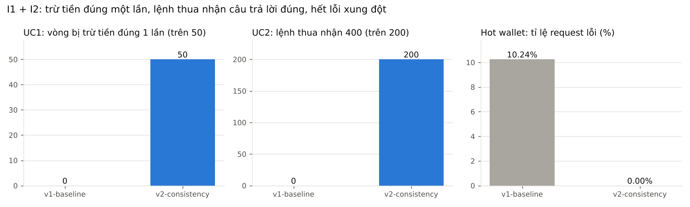
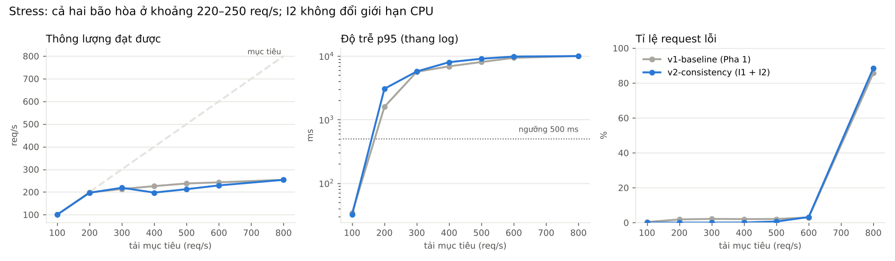

# Kết quả I1 + I2: Idempotency-Key và cập nhật số dư nguyên tử

I1 + I2 sửa hoàn toàn hai lỗi về tính đúng đắn mà Pha 1 để lại: một thanh toán gửi lặp lại giờ chỉ bị trừ tiền **đúng một lần**, và khi hai giao dịch tranh nhau số dư, giao dịch thua nhận câu trả lời đúng (**400 "không đủ số dư"**) thay vì lỗi xung đột 409. Hiệu năng không đổi trong phạm vi nhiễu: cả hai phiên bản đều bị giới hạn bởi CPU ở khoảng 220–250 req/s.

Thuộc tính chất lượng cải thiện: **độ tin cậy / tính nhất quán dữ liệu** (reliability, consistency). Không nhằm cải thiện hiệu năng.

## 1. Thay đổi

| | Vấn đề ở Pha 1 | Giải pháp |
| --- | --- | --- |
| **I1** | Server tự sinh `reference_code` ngẫu nhiên cho mọi request, nên không phân biệt được "gửi lại" với "thanh toán mới". Gửi lặp bị trừ tiền nhiều lần. | Client gửi header `Idempotency-Key`; key được lưu làm `reference_code` (cột `UNIQUE`). Cùng key + cùng nội dung → trả lại giao dịch cũ, không trừ tiền. Cùng key + khác nội dung → 422. Áp dụng cho topup, withdraw, transfer. |
| **I2** | Đọc số dư → kiểm tra trong Java → ghi lại. Hai request đồng thời cùng qua bước kiểm tra; `@Version` chặn request sau bằng **409**. | Một câu `UPDATE wallets SET balance = balance - :amount ... WHERE id = :id AND status = 'ACTIVE' AND balance >= :amount`. MySQL khóa dòng nên các lệnh trừ tiền chạy lần lượt; lệnh thua thấy 0 dòng cập nhật → 400. Transfer khóa ví theo `id` tăng dần để tránh deadlock. |

Chi tiết thiết kế: [architecture.md](../architecture.md), mục 5.

## 2. Cách đo

- **Cùng một phiên Kaggle, cùng một máy:** notebook `digitalwallet-stress-test/v2/LoadTest.ipynb` chạy mỗi bài test lần lượt cho cả hai phiên bản, đảo thứ tự xen kẽ (A B, B A, ...).
- **Vì sao phải đo cùng phiên:** ba lần chạy baseline ở ba phiên Kaggle khác nhau cho thông lượng tối đa chênh tới ~50 % (257, 378 và 344 req/s đạt được ở mức tải 800 req/s) dù code giống hệt. So sánh hai phiên bản từ hai phiên khác nhau sẽ cho kết luận sai.
- **Máy:** Intel Xeon 2.20 GHz, 2 lõi vật lý × 2 luồng. App + MySQL ghim vào CPU 0,2 (lõi vật lý 0), k6 ghim vào CPU 1,3 (lõi vật lý 1), để công cụ tạo tải không lấy CPU của app.
- **Commit:** bộ test `a436844`; `v1-baseline` = `1bad824` (code gốc Pha 1); `v2-consistency` = `3773e20` (I1 + I2).
- **Bài test:**

| Bài test | Mô tả |
| --- | --- |
| load | 100 req/s trong 10 phút, hỗn hợp đọc/ghi, 300 user |
| hot | 100 req/s trong 5 phút, mọi lệnh chuyển tiền đều vào **một** ví (tranh chấp tối đa) |
| history | 100 req/s trong 5 phút, mỗi user có sẵn 200 giao dịch cũ |
| stress | cùng hỗn hợp ở 100, 200, 300, 400, 500, 600, 800 req/s, mỗi mức 2 phút |
| UC1 | 50 vòng, mỗi vòng gửi đồng thời 20 lệnh chuyển giống hệt, cùng một `Idempotency-Key` |
| UC2 | 200 vòng, mỗi vòng gửi đồng thời 2 lệnh chuyển 600.000 từ ví có 1.000.000 |
| money check | sau mỗi bài load/hot/history: tổng số dư = tổng nạp − tổng rút, mỗi ví khớp sổ giao dịch, không ví nào âm |

## 3. Tính đúng đắn

| Bài test | v1-baseline | v2-consistency |
| --- | --- | --- |
| UC1: vòng bị trừ tiền đúng 1 lần (trên 50) | 0 | **50** |
| UC1: số lần trừ tiền thừa | 63 | **0** |
| UC2: lệnh thua nhận 409 / 400 (trên 200) | 200 / 0 | **0 / 200** |
| UC2: cả hai lệnh cùng thành công / sai số dư | 0 / 0 | 0 / 0 |
| Hot wallet: tỉ lệ lỗi (số lỗi 409) | 10,24 % (3.073) | **0 %** (0) |
| Load 100 req/s: tỉ lệ lỗi (số lỗi 409) | 0,22 % (135) | **0 %** (0) |
| Money check (load, hot, history) | OK | OK |

Trên toàn bộ các bài test, v2 không sinh ra **lỗi 409 nào**. Ở Pha 1 tiền cũng không bị sai (money check OK, UC2 không có vòng nào cả hai cùng thành công), nhưng người dùng bị trừ tiền nhiều lần khi gửi lặp và nhận lỗi xung đột thay vì câu trả lời đúng.

## 4. Hiệu năng

| Bài test | v1 p95 | v2 p95 | v1 p99 | v2 p99 |
| --- | --- | --- | --- | --- |
| Load 100 req/s | 31 ms | 25 ms | 46 ms | 35 ms |
| Hot wallet 100 req/s | 31 ms | 35 ms | 46 ms | 66 ms |
| History 100 req/s | 173 ms | 138 ms | 424 ms | 339 ms |

| Tải mục tiêu (req/s) | v1 đạt được | v2 đạt được | v1 p95 | v2 p95 | v1 lỗi | v2 lỗi |
| --- | --- | --- | --- | --- | --- | --- |
| 100 | 100 | 100 | 34 ms | 32 ms | 0,32 % | 0 % |
| 200 | 198 | 197 | 1,6 s | 3,1 s | 1,82 % | 0 % |
| 300 | 213 | 219 | 5,7 s | 5,7 s | 2,12 % | 0 % |
| 400 | 226 | 197 | 6,9 s | 8,0 s | 2,00 % | 0,05 % |
| 500 | 238 | 213 | 8,1 s | 9,1 s | 2,06 % | 0,60 % |
| 600 | 243 | 229 | 9,4 s | 9,8 s | 2,96 % | 3,19 % |
| 800 | 254 | 254 | 10 s | 10 s | 85,7 % | 88,6 % |

Nhận xét:

- **Giới hạn là CPU, không phải khóa.** Cả hai phiên bản bão hòa ở khoảng 220–250 req/s trên một lõi vật lý. I2 bỏ các request lỗi nhưng không làm mỗi request rẻ hơn, nên giới hạn không đổi. Tải tối đa duy trì được (p95 < 500 ms, lỗi < 1 %) là **100 req/s cho cả hai** trong phiên này. Máy của phiên này chậm hơn các phiên baseline trước, nơi v1 còn qua được mức 200 req/s.
- **Hot wallet chậm hơn một chút ở đuôi (p99 46 → 66 ms), và đây là đánh đổi có chủ đích.** v1 từ chối ngay các request tranh chấp bằng 409: nhanh nhưng sai với người dùng. v2 cho chúng chờ lượt khóa dòng rồi xử lý đúng.
- **Mức 200 req/s nằm đúng điểm bão hòa**, nơi kết quả dao động mạnh giữa các lần chạy. Thông lượng thành công gần như bằng nhau (v1 ~194 req/s thành công, v2 ~197 req/s). Không kết luận được phiên bản nào tốt hơn ở mức này từ một lần chạy.
- Từ 300 req/s trở lên cả hai đều quá tải (độ trễ vài giây, k6 không gửi kịp hàng nghìn request). Ở 800 req/s cả hai sụp: phần lớn request hết thời gian chờ 10 s.

## 5. Hạn chế còn lại

- **Bản sao trùng key đến cùng một lúc nhận lỗi thay vì kết quả gốc.** Trong UC1, 39 % request của v2 bị lỗi: khi nhiều bản sao cùng key đến đồng thời, chỉ một bản ghi được giao dịch; các bản còn lại bị ràng buộc `UNIQUE` chặn và transaction của chúng rollback. Tiền luôn đúng (`extra_debits = 0`), nhưng client nhận lỗi thay vì giao dịch gốc. Cách sửa: adapter bắt lỗi trùng khóa, chuyển thành exception nghiệp vụ, rồi đọc lại giao dịch gốc trong một transaction mới.
- **Mới có một lần đo theo cặp.** Kết quả tính đúng đắn ổn định (giống hệt ở cả ba lần chạy baseline trước), nhưng các so sánh độ trễ nhỏ nên được xác nhận bằng thêm một hai phiên đo.

## 6. Bước tiếp theo

Muốn tăng thông lượng phải giảm công việc trên mỗi request (I3: cache + phân trang lịch sử). Dữ liệu chỉ ra chỗ cần làm: endpoint lịch sử giao dịch chậm nhất (p95 138–173 ms so với ~25–31 ms bình thường), và khoảng một nửa số request là đọc.

## Dữ liệu gốc

[`../stress-test/results/v1-baseline_vs_v2-consistency/`](../stress-test/results/v1-baseline_vs_v2-consistency/), mỗi phiên bản một thư mục:

- `<test>.json`: tóm tắt của k6 (`--summary-export`)
- `<test>.txt`: output đầy đủ của k6
- `<test>_money.json`: kết quả money check
- `machine.txt`: thông tin CPU và commit đã đo
